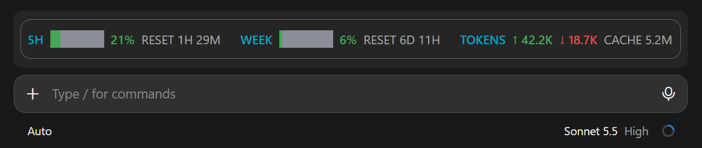
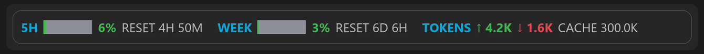

# usage-band



The bars change color as the limits fill up (animated illustration of the band):



A Claude Code mod that draws a band above the prompt with:

- **5H**: how much of the 5-hour limit is used, with time until reset
- **WEEK**: how much of the weekly limit is used, with time until reset
- **TOKENS**: input (↑), output (↓) and cached tokens spent in the current session

The bars turn yellow above 70% and red above 80%.

## Install

At the prompt of a terminal session:

```
/plugin install usage-band --marketplace sshyngys1/usage-band
```

From a shell:

```
claude plugin install usage-band --marketplace sshyngys1/usage-band
```

In the desktop app, where `/plugin` does not run: click + next to the prompt box, then Plugins, Add marketplace with `sshyngys1/usage-band`, then Add plugin.
